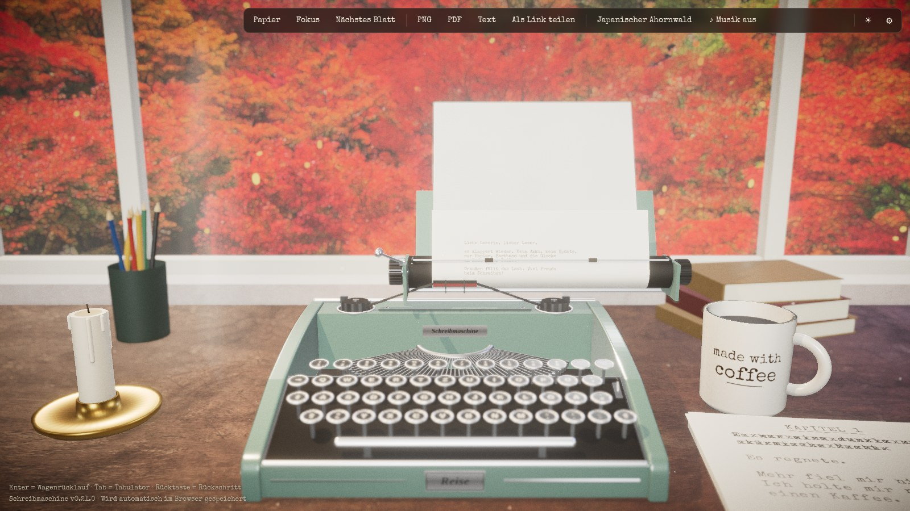
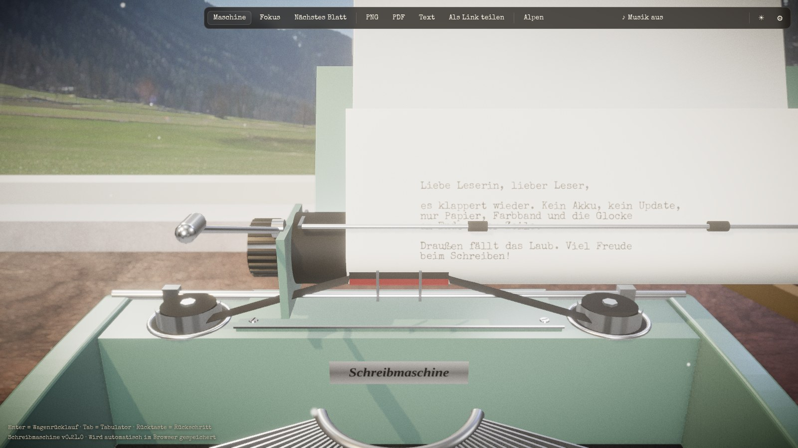
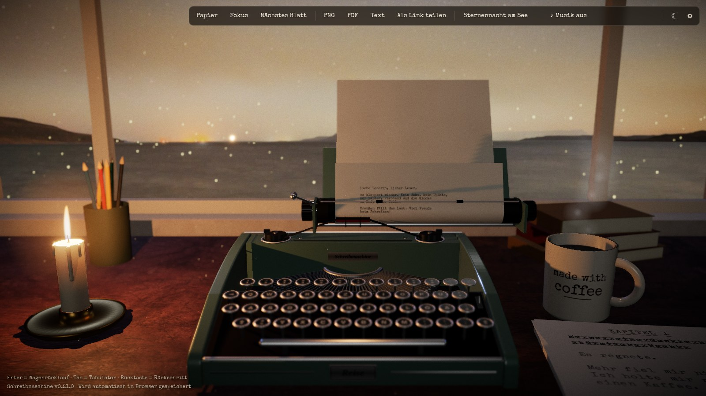

# Schreibmaschine

**Eine alte Reiseschreibmaschine – direkt im Browser.**
Tippen, das Klacken hören, die Glocke am Zeilenende abwarten, den Wagen zurückschieben.
Ohne Installation, ohne Konto, auf jedem Rechner.

### ▶ [Jetzt ausprobieren: s84n.github.io/Schreibmaschine](https://s84n.github.io/Schreibmaschine/)



---

## Worum es geht

Manchmal will man einfach nur schreiben. Keine Rechtschreibkorrektur, kein Cursor, der
blinkt, keine Benachrichtigungen – nur ein Blatt Papier und eine Maschine, die bei
jedem Buchstaben ein kleines bisschen Widerstand leistet.

**Schreibmaschine** holt dieses Gefühl auf den Bildschirm. Auf dem Schreibtisch steht eine
salbeigrüne Reiseschreibmaschine im Stil der 1950er-Jahre. Du tippst auf deiner ganz
normalen Tastatur – und die Maschine antwortet:

- Die **Taste** sinkt ein, der **Typenhebel** schnellt aus dem Korb nach oben und schlägt
  gegen die Walze, das **Farbband** hebt sich, der **Wagen** rückt einen Schritt weiter.
- Jeder Buchstabe landet mit **echter Tinten-Unregelmäßigkeit** auf dem Papier: mal etwas
  kräftiger, mal blasser, nie zweimal gleich.
- Acht Anschläge vor dem Rand **klingelt die Glocke**. Mit Enter schwingt der Hebel, die
  Walze dreht eine Zeile weiter und der Wagen rauscht zurück.
- Die Geräusche stammen von **echten Schreibmaschinen-Aufnahmen**.

Dazu ein ruhiges Zimmer: weiße Wände, ein Holztisch, eine Kaffeetasse, ein Regal mit
Efeutute – und ein Fenster, durch das du hinausschaust.





## Was du alles machen kannst

| | |
|---|---|
| ✍️ **Schreiben** | Einfach lostippen. Rücktaste setzt den Wagen zurück – Überschreiben wie früher inklusive. |
| 🏔️ **Aussicht wählen** | Alpen, Bergsee im Winter, nordischer See, Mittelmeer, Istanbul, ein Büro hoch über Manhattan, Dubai in der Dämmerung oder eine Sternennacht am See. |
| 🎷 **Musik an** | Ruhiger Lo-Fi-Jazz mit E-Piano und Plattenknistern – wird live im Browser erzeugt und wiederholt sich nie exakt. |
| 💾 **Nichts verlieren** | Dein Blatt wird automatisch im Browser gespeichert und ist beim nächsten Besuch wieder da. |
| 📄 **Exportieren** | Die fertige Seite als **PNG**, als **PDF** (A4) oder als reinen **Text** herunterladen. |
| 📃 **Neues Blatt** | Das alte Blatt wird herausgedreht, ein neues eingespannt. |
| 🕯️ **Tag & Nacht** | Nachts brennt links eine Kerze mit flackerndem Licht, über dem Fenster leuchtet eine Lichterkette. |
| 🎀 **Farbband wechseln** | Schwarz, Rot, Königsblau, Tannengrün, Violett oder Sepia – Geschriebenes behält seine Farbe. |
| 🏛️ **Modell wählen** | Reise (1950er), Kontor (1930er, Messing) oder Flach (1960er) – eigene Entwürfe mit derselben Mechanik. |
| 🌧️ **Regenwetter** | Tropfen laufen die Scheibe hinab, dazu Regen mit Prasseln an der Scheibe und Tropfen vom Dach – per Schalter an und aus. |
| 🎨 **Anpassen** | Gehäusefarbe (Salbeigrün, Bordeaux, Schwarz, Creme), QWERTZ oder QWERTY, Deutsch oder Englisch, zwei Grafikstufen. |
| 📲 **Am Smartphone** | Im Querformat; ⌨ öffnet die Tastatur, alles Weitere liegt im Zahnrad-Menü. |
| 📱 **Als App installieren** | Die Seite lässt sich wie eine App installieren und funktioniert danach auch **offline**. |

### Tasten

| Taste | Was passiert |
|---|---|
| Buchstaben, Zahlen, Zeichen | Anschlag |
| Enter | Wagenrücklauf und Zeilenschaltung |
| Rücktaste | Ein Schritt zurück (zum Überschreiben) |
| Tab | Sprung zum nächsten Tabulator |
| Umschalt / Feststelltaste | Großbuchstaben – der Typenkorb senkt sich sichtbar ab |

## Wie es gemacht ist

Alles, was du siehst, entsteht im Browser – es gibt keinen Server und kein 3D-Modell
zum Herunterladen.

- **Die Maschine** ist komplett im Code gebaut: Gehäuse, rund 50 Tasten, ein Fächer aus
  Typenhebeln, Walze, Farbband und Wagen sind einzelne Teile, die sich unabhängig
  bewegen. Gerendert wird mit **[Three.js](https://threejs.org)** (WebGL).
- **Der Film-Look** – Tiefenschärfe auf den Druckpunkt, sanftes Glühen auf Chrom,
  Filmkorn und Vignette – kommt aus der Shader-Bibliothek
  **[postprocessing](https://github.com/pmndrs/postprocessing)**.
- **Das Papier** ist eine gezeichnete Textur, die sich um die Walze biegt. Jeder
  Buchstabe wird mit eigenem Zufallswert aufgedruckt – deshalb sieht der Export genauso
  aus wie das Blatt in der Maschine.
- **Der Klang** läuft über die **Web Audio API**: echte Aufnahmen, leicht in Tonhöhe und
  Lautstärke variiert, mit etwas Kompression und einem Hauch Raumhall.
- **Die Musik** wird ebenfalls mit Web Audio erzeugt – Akkorde, Bass, Schlagzeug und
  Knistern sind kleine Synthesizer, gesteuert von einem Sequenzer.
- **Gebaut** mit [Vite](https://vite.dev) und TypeScript, **veröffentlicht** automatisch
  über GitHub Pages, **installierbar** dank [vite-plugin-pwa](https://vite-pwa-org.netlify.app).

Wer selbst daran basteln möchte:

```bash
npm install
npm run dev
```

Planung und Ideen stehen in [`plan.md`](plan.md), alle Änderungen in
[`CHANGELOG.md`](CHANGELOG.md).

## Quellen & Danksagung

Dieses Projekt steht auf den Schultern von Menschen, die ihre Arbeit frei teilen. Danke!

**Klänge** – [Wikimedia Commons](https://commons.wikimedia.org)
- Tastenanschläge: [„Smith-Corona Prestige Auto 12 typing“](https://commons.wikimedia.org/wiki/File:Smith-Corona_Prestige_Auto_12_typing.ogg) von **lonemonk**, [CC BY 3.0](https://creativecommons.org/licenses/by/3.0/)
- Wagenrücklauf: [„WWS Typewriter“](https://commons.wikimedia.org/wiki/File:WWS_Typewriter.ogg) von **Work With Sounds / Konrad Gutkowski**, [CC BY 4.0](https://creativecommons.org/licenses/by/4.0/)
- Glocke: [„typewriter-ding-near-mono“](https://commons.wikimedia.org/wiki/File:406243_stubb_typewriter-ding-near-mono.wav) von **_stubb**, CC0

**Aussichten aus dem Fenster**
- [Poly Haven](https://polyhaven.com) (CC0): Alpen, Bergsee im Winter, nordischer See, Mittelmeer, Sternennacht
- [„Galata panorama 1“](https://commons.wikimedia.org/wiki/File:Galata_panorama_1_-_panoramio.jpg) von **müşfik öztürk**, [CC BY 3.0](https://creativecommons.org/licenses/by/3.0/)
- [„New York march 2025 Gn-092“](https://commons.wikimedia.org/wiki/File:New_York_march_2025_Gn-092.jpg) von **Gnangarra**, [CC BY 2.5 AU](https://creativecommons.org/licenses/by/2.5/au/deed.en)
- [„Dubai skyscrapers“](https://commons.wikimedia.org/wiki/File:Dubai_skyscrapers.jpg) von **Challiyan**, [CC BY-SA 3.0](https://creativecommons.org/licenses/by-sa/3.0/)

**Texturen** – [Poly Haven](https://polyhaven.com) (CC0): Holztisch, Putzwand, Dielenboden

**Schrift** – [Special Elite](https://fonts.google.com/specimen/Special+Elite) von Astigmatic, Apache License 2.0

Die Klänge wurden zugeschnitten und im Pegel angepasst, die Fotos verkleinert und zu
Panoramabändern erweitert. Details stehen in [`public/sounds/LICENSES.md`](public/sounds/LICENSES.md),
[`public/views/LICENSES.md`](public/views/LICENSES.md) und
[`public/textures/LICENSES.md`](public/textures/LICENSES.md).
