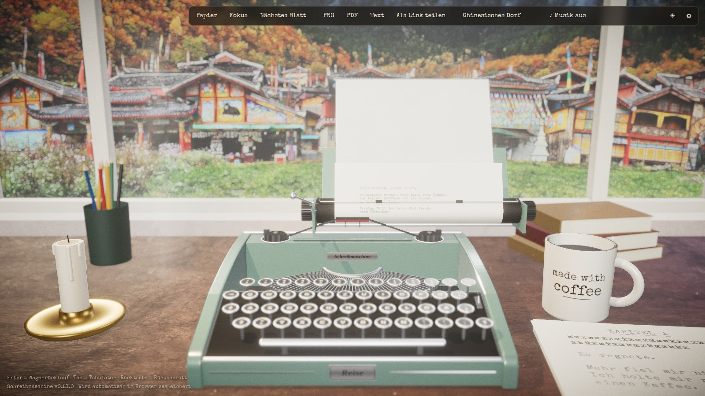
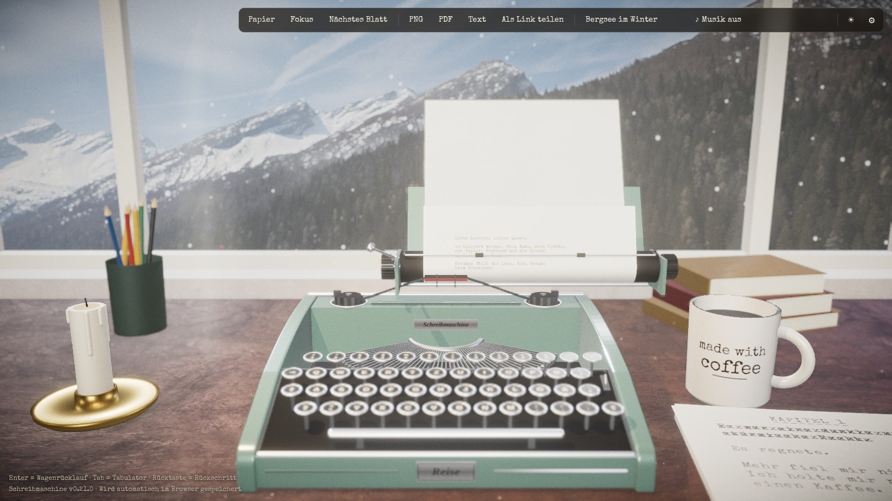
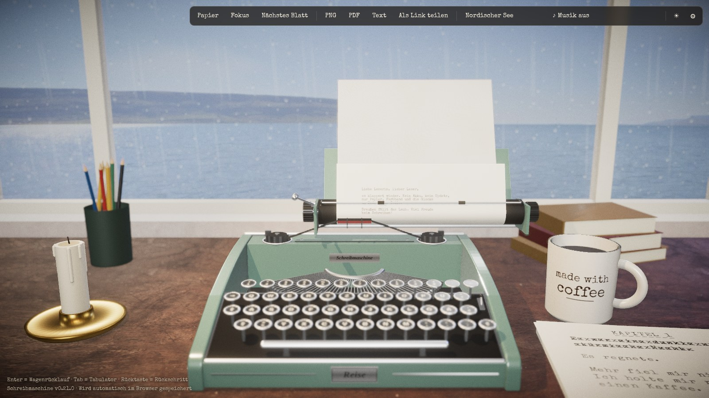
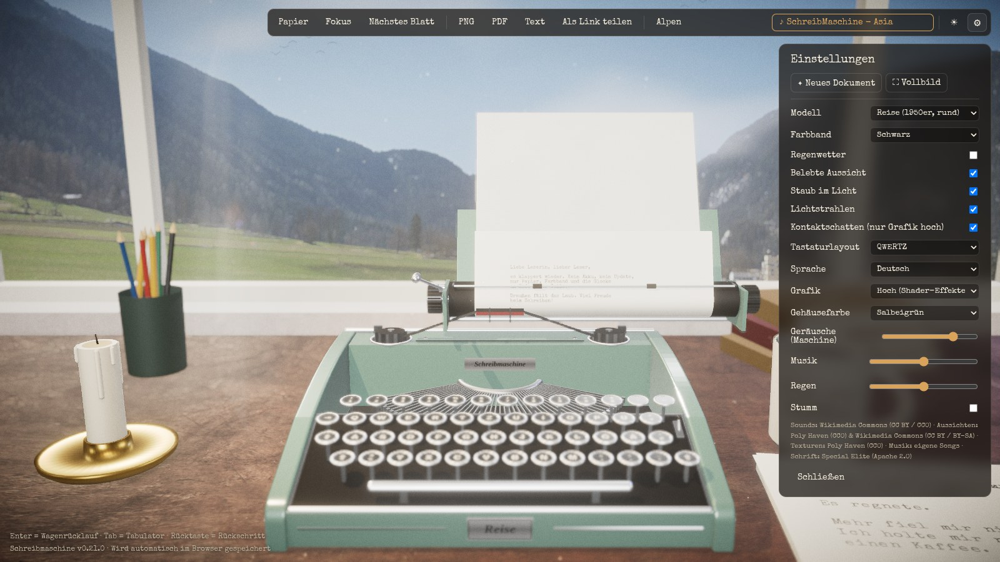

# Schreibmaschine

**Eine alte Reiseschreibmaschine – direkt im Browser.**
Tippen, das Klacken hören, die Glocke am Zeilenende abwarten, den Wagen zurückschieben.
Ohne Installation, ohne Konto, auf jedem Rechner.

### ▶ [Jetzt ausprobieren: s84n.github.io/Schreibmaschine](https://s84n.github.io/Schreibmaschine/)


---

## Worum es geht

Manchmal will man einfach nur schreiben. Keine Rechtschreibkorrektur, kein Cursor, der
blinkt, keine Benachrichtigungen – nur ein Blatt Papier und eine Maschine, die bei
jedem Buchstaben ein kleines bisschen Widerstand leistet.

**Schreibmaschine** holt dieses Gefühl auf den Bildschirm. Auf dem Schreibtisch steht eine
salbeigrüne Reiseschreibmaschine im Stil der 1950er-Jahre. Du tippst auf deiner ganz
normalen Tastatur – und die Maschine antwortet:

- Die **Taste** sinkt ein, der **Typenhebel** schnellt aus dem Korb nach oben und schlägt
  gegen die Walze, das **Farbband** hebt sich, der **Wagen** rückt einen Schritt weiter.
- Jeder Buchstabe landet mit **echter Tinten-Unregelmäßigkeit** auf dem Papier: mal etwas
  kräftiger, mal blasser, nie zweimal gleich.
- Acht Anschläge vor dem Rand **klingelt die Glocke**. Mit Enter schwingt der Hebel, die
  Walze dreht eine Zeile weiter und der Wagen rauscht zurück.
- Die Geräusche stammen von **echten Schreibmaschinen-Aufnahmen**.

Dazu ein ruhiges Zimmer: weiße Wände, ein Holztisch, eine Kaffeetasse, Kerze und Bücher –
und ein großes Panoramafenster, hinter dem sich die Welt bewegt.










## Was du alles machen kannst

| | |
|---|---|
| ✍️ **Schreiben** | Einfach lostippen. Rücktaste setzt den Wagen zurück – Überschreiben wie früher inklusive. |
| 🏔️ **Aussicht wählen** | Alpen, Bergsee im Winter, nordischer See, Mittelmeer, ein chinesisches Dorf, ein japanischer Ahornwald, Rio de Janeiro, Paris, Udaipur, Elmina, Granada, Buenos Aires, Machu Picchu, die Serengeti, Istanbul, ein Büro hoch über Manhattan, Dubai in der Dämmerung oder eine Sternennacht am See. |
| 🌿 **Lebendige Aussicht** | Hinter dem großen Panoramafenster ziehen Wolken, das Wasser kräuselt sich, Wind geht durchs Laub, und je nach Ort fliegen Vögel, fällt Schnee, segeln Ahornblätter oder tanzen Glühwürmchen – per Schalter an und aus. |
| 🎷 **Musik wählen** | Drei eigene Songs laufen in Dauerschleife: Asia, Middle East und America. |
| 🎚️ **Alles einzeln regeln** | Geräusche der Maschine, Musik und Regen haben je einen eigenen Lautstärkeregler. |
| 💾 **Nichts verlieren** | Dein Blatt wird automatisch im Browser gespeichert und ist beim nächsten Besuch wieder da. |
| 📄 **Exportieren** | Die fertige Seite als **PNG**, als **PDF** (A4) oder als reinen **Text** herunterladen. |
| 📚 **Manuskript** | Fertige Blätter landen auf dem Stapel; PDF und Text enthalten alle Seiten. |
| 🆕 **Neues Dokument** | Im Zahnrad-Menü: legt alle Blätter in die Schublade und beginnt von vorn, damit im nächsten Export nichts Altes auftaucht. |
| 💌 **Brief als Link** | Der Empfänger sieht deinen Text Anschlag für Anschlag entstehen. Er steckt nur im Link, auf keinem Server. |
| 🌦️ **Stimmungen** | Ein Klick auf Regennacht, Sonntagmorgen, Herbst in Kyoto, Winterabend, Sternennacht oder Am Bosporus stellt Aussicht, Licht, Wetter, Musik und Anschlag zusammen. |
| 🕹️ **Das Zimmer bedienen** | Kerze, Lampe, Fenster, Radio und Papierstapel lassen sich direkt anklicken. Ein Punkt zeigt, was geht, bis du es einmal benutzt hast; unter der Maus leuchtet es auf und sagt, was es tut. |
| 🎯 **Nur noch schreiben** | Nach drei Anschlägen verschwinden Leisten und Mauszeiger, bei Mausbewegung oder Esc sind sie wieder da. |
| 📖 **Nachlesen** | Alle Blätter flach und in Ruhe lesen, mit den Pfeiltasten umblättern. |
| 🗄️ **Schublade** | „Neues Dokument“ legt das Manuskript hier ab. Von dort kannst du es lesen, wieder einspannen oder löschen. |
| ↩️ **Sanfter Umbruch** | Am Zeilenende rutscht das Wort in die nächste Zeile, und ein volles Blatt wird von selbst gewechselt. Abschaltbar. |
| ✂️ **Korrekturband** | Umschalt + Rücktaste entfernt ein Zeichen sauber. Per Schalter tut das auch die normale Rücktaste. |
| 🪶 **Sanfter Anschlag** | Gedämpft wie auf Filz, dazu eigene Regler für Glocke und Wagenrücklauf. |
| 👀 **Augen schonen** | Größere Schrift beim Lesen, warmes Creme-Papier und ruhige Bewegung ohne Flackern. |
| 🔋 **Leiser Lüfter** | Im Stillstand sinkt die Bildrate von selbst. Dazu gibt es einen Akku-Modus. |
| 🕯️ **Tag & Nacht** | Nachts brennt rechts neben der Tasse eine Kerze mit flackerndem Licht, die grüne Bankerlampe wirft warmes Leselicht aufs Papier, über dem Fenster leuchtet eine Lichterkette. |
| 🎀 **Farbband wechseln** | Schwarz, Rot, Königsblau, Tannengrün, Violett oder Sepia – Geschriebenes behält seine Farbe. |
| 🏛️ **Modell wählen** | Reise (1950er), Kontor (1930er, Messing) oder Flach (1960er) – eigene Entwürfe mit derselben Mechanik. |
| 🌧️ **Regenwetter** | Tropfen laufen die Scheibe hinab, dazu leises Prasseln und im Hintergrund Tropfen auf dem Dach – per Schalter an und aus, mit eigenem Lautstärkeregler. |
| ✨ **Grafik-Effekte** | Staub im Licht, Lichtstrahlen und Kontaktschatten – jeweils per Schalter. Fünf Aussichten sowie Dorf und Ahornwald liegen in hoher Auflösung bis 8K vor. |
| 🎨 **Anpassen** | Gehäusefarbe (Salbeigrün, Bordeaux, Schwarz, Creme), QWERTZ oder QWERTY, Deutsch oder Englisch, zwei Grafikstufen. |
| 📲 **Am Smartphone** | Im Querformat; ⌨ öffnet die Tastatur, alles Weitere liegt im Zahnrad-Menü. |
| 📱 **Als App installieren** | Die Seite lässt sich wie eine App installieren und funktioniert danach auch **offline**. Nur Songs brauchen Internet, und Aussichten stehen offline bereit, sobald du sie einmal geöffnet hast. |

### Tasten

| Taste | Was passiert |
|---|---|
| Buchstaben, Zahlen, Zeichen | Anschlag |
| Enter | Wagenrücklauf und Zeilenschaltung |
| Rücktaste | Ein Schritt zurück (zum Überschreiben) |
| Umschalt + Rücktaste | Korrekturband: Zeichen entfernen |
| Esc | Offenes Fenster schließen, Oberfläche zurückholen |
| Tab | Sprung zum nächsten Tabulator |
| Umschalt / Feststelltaste | Großbuchstaben – der Typenkorb senkt sich sichtbar ab |

## Wie es gemacht ist

Alles, was du siehst, entsteht im Browser – es gibt keinen Server und kein 3D-Modell
zum Herunterladen.

- **Die Maschine** ist komplett im Code gebaut: Gehäuse, rund 50 Tasten, ein Fächer aus
  Typenhebeln, Walze, Farbband und Wagen sind einzelne Teile, die sich unabhängig
  bewegen. Gerendert wird mit **[Three.js](https://threejs.org)** (WebGL).
- **Der Film-Look** – Tiefenschärfe auf den Druckpunkt, sanftes Glühen auf Chrom,
  Filmkorn und Vignette – kommt aus der Shader-Bibliothek
  **[postprocessing](https://github.com/pmndrs/postprocessing)**.
- **Das Papier** ist eine gezeichnete Textur, die sich um die Walze biegt. Jeder
  Buchstabe wird mit eigenem Zufallswert aufgedruckt – deshalb sieht der Export genauso
  aus wie das Blatt in der Maschine.
- **Der Klang** läuft über die **Web Audio API**: echte Aufnahmen, ergänzt um Taste, Walze,
  Gehäuse, Schaltklinke und zurückfallenden Hebel. Jede Taste klingt etwas anders, schnelles
  Tippen weicher. Der Regen wird komplett im Browser erzeugt.
- **Die Aussicht** lebt im Shader: Wolken, Wellen und Wind entstehen in Echtzeit auf dem
  Panoramafoto, Vögel, Schnee und Blätter sind Partikel davor. Videos sind dafür nicht nötig.
- **Die Musik** sind eigene, mit KI erstellte Songs aus `public/music`.
- **Gebaut** mit [Vite](https://vite.dev) und TypeScript, **veröffentlicht** automatisch
  über GitHub Pages, **installierbar** dank [vite-plugin-pwa](https://vite-pwa-org.netlify.app).

Wer selbst daran basteln möchte:

```bash
npm install
npm run dev
```

Planung und Ideen stehen in [`plan.md`](plan.md), alle Änderungen in
[`CHANGELOG.md`](CHANGELOG.md).

## Quellen & Danksagung

Dieses Projekt steht auf den Schultern von Menschen, die ihre Arbeit frei teilen. Danke!

**Klänge** – [Wikimedia Commons](https://commons.wikimedia.org)
- Tastenanschläge: [„Smith-Corona Prestige Auto 12 typing“](https://commons.wikimedia.org/wiki/File:Smith-Corona_Prestige_Auto_12_typing.ogg) von **lonemonk**, [CC BY 3.0](https://creativecommons.org/licenses/by/3.0/)
- Wagenrücklauf: [„WWS Typewriter“](https://commons.wikimedia.org/wiki/File:WWS_Typewriter.ogg) von **Work With Sounds / Konrad Gutkowski**, [CC BY 4.0](https://creativecommons.org/licenses/by/4.0/)
- Glocke: [„typewriter-ding-near-mono“](https://commons.wikimedia.org/wiki/File:406243_stubb_typewriter-ding-near-mono.wav) von **_stubb**, CC0

**Aussichten aus dem Fenster**
- [Poly Haven](https://polyhaven.com) (CC0): Alpen, Bergsee im Winter, nordischer See, Mittelmeer, Sternennacht
- [„Tofuku-ji, Kyoto“](https://commons.wikimedia.org/wiki/File:Tofuku-ji,_Kyoto_-_Tofukuji6598.jpg) von **lumoplank**, CC0
- [„Jiuzhaigou Valley, Shuzheng Village panorama“](https://commons.wikimedia.org/wiki/File:1_jiuzhaigou_valley_shuzheng_village_panorama_2011.jpg) von **Chensiyuan**, [CC BY-SA 4.0](https://creativecommons.org/licenses/by-sa/4.0/)
- [„Galata panorama 1“](https://commons.wikimedia.org/wiki/File:Galata_panorama_1_-_panoramio.jpg) von **müşfik öztürk**, [CC BY 3.0](https://creativecommons.org/licenses/by/3.0/)
- [„New York march 2025 Gn-092“](https://commons.wikimedia.org/wiki/File:New_York_march_2025_Gn-092.jpg) von **Gnangarra**, [CC BY 2.5 AU](https://creativecommons.org/licenses/by/2.5/au/deed.en)
- [„Dubai skyscrapers“](https://commons.wikimedia.org/wiki/File:Dubai_skyscrapers.jpg) von **Challiyan**, [CC BY-SA 3.0](https://creativecommons.org/licenses/by-sa/3.0/)

- [„Panorama do Rio de Janeiro“](https://commons.wikimedia.org/wiki/File:Panorama_do_Rio_de_Janeiro_a_partir_do_Parque_das_Ru%C3%ADnas_2024_11_24.jpg) von **Tet**, [CC BY 4.0](https://creativecommons.org/licenses/by/4.0/)
- [„Paris panorama from the top of the Sacré-Cœur“](https://commons.wikimedia.org/wiki/File:Paris_panorama_from_the_top_of_the_Sacr%C3%A9-C%C5%93ur_Basilica,_July_2015.jpg) von **Joe deSousa**, CC0
- [„Lake palace 05a“](https://commons.wikimedia.org/wiki/File:Lake_palace_05a.jpg) von **KenWalker**, [CC BY-SA 3.0](https://creativecommons.org/licenses/by-sa/3.0/)
- [„Castle, Elmina“](https://commons.wikimedia.org/wiki/File:Castle,_Elmina_(P1100203-Pano).jpg) von **Matti Blume**, [CC BY-SA 4.0](https://creativecommons.org/licenses/by-sa/4.0/)
- [„Alhambra evening panorama“](https://commons.wikimedia.org/wiki/File:Alhambra_evening_panorama_Mirador_San_Nicolas_sRGB-1.jpg) von **Slaunger**, [CC BY-SA 3.0](https://creativecommons.org/licenses/by-sa/3.0/)
- [„Panorama boca000“](https://commons.wikimedia.org/wiki/File:Panorama_boca000.jpg) von **Moemoemoe**, CC0
- [„99 - Machu Picchu“](https://commons.wikimedia.org/wiki/File:99_-_Machu_Picchu_-_Juin_2009.jpg) von **Martin St-Amant**, [CC BY-SA 3.0](https://creativecommons.org/licenses/by-sa/3.0/)
- [„Sunrise at Serengeti National Park“](https://commons.wikimedia.org/wiki/File:004_Sunrise_at_Serengeti_National_Park_Photo_by_Giles_Laurent.jpg) von **Giles Laurent**, [CC BY-SA 4.0](https://creativecommons.org/licenses/by-sa/4.0/)

**Musik** – eigene Songs des Projekts, erstellt mit KI

**Texturen** – [Poly Haven](https://polyhaven.com) (CC0): Mahagoni, Putzwand, Dielenboden

**Schrift** – [Special Elite](https://fonts.google.com/specimen/Special+Elite) von Astigmatic, Apache License 2.0

Die Klänge wurden zugeschnitten und im Pegel angepasst, die Fotos zugeschnitten, in Farbe
angepasst und zu Panoramabändern erweitert. Details stehen in [`public/sounds/LICENSES.md`](public/sounds/LICENSES.md),
[`public/views/LICENSES.md`](public/views/LICENSES.md) und
[`public/textures/LICENSES.md`](public/textures/LICENSES.md).
